# Seed43 圖表總覽

日期：2026-10-21。沿用 seed42 的既有繪圖函式、版面、顏色、線型與標記，資料均來自 seed43 四模型；每張提供 300 dpi PNG 與向量 PDF。原 seed42 圖片、訓練程式、模型與評估結果皆保留。

RMSE 圖使用完整的四組內部 test 與八組外插案例，逐例呈現 H1、H18、時序 TS 的原始 RMSE，沒有跨案例平均。KCI 使用完整 4,385 個 in-range／2,692 個 Soft-OOD 操作點；四模型有效 coverage 相同，分別為 87.0468%／79.6155%。

分組 KCI 圖每個有效操作點／配對包含正負擾動 × 18 步，共 36 筆比較。誤差棒為按操作點重抽樣 2,000 次的 95% percentile bootstrap 區間；bootstrap 基準 seed 為 42（沿用原分析設定），不是訓練 seed43 的跨種子變異。重新計算的分組資料已逐配對核對，與既有 seed43 官方 KCI 的有效數、正確數完全一致。

Teacher 分布使用同一個凍結 ANN teacher 與相同測試操作點，因此與 seed42 相同是預期結果。圖下注解採通用的「輸入／輸出 normalization scales」用語，避免沿用舊圖未經確認的 IQR 標示；數值計算未改變。

SS 比較圖包含 seed43 已完成的 No-Gain、Gain＋SS=0.01、Difficult-GradNorm 三條曲線，與舊圖的多 SS 權重掃描範圍不同。

每張圖下方可開啟 PNG 原圖或 PDF；`four_model_rmse_visualization_seed43/figure_provenance.json` 保存來源、bootstrap 設定與檔案 SHA256。

## 四模型原始 RMSE：內部 test

[PNG 原圖](four_model_rmse_visualization_seed43/four_model_raw_rmse_internal_test.png) · [PDF](four_model_rmse_visualization_seed43/four_model_raw_rmse_internal_test.pdf)

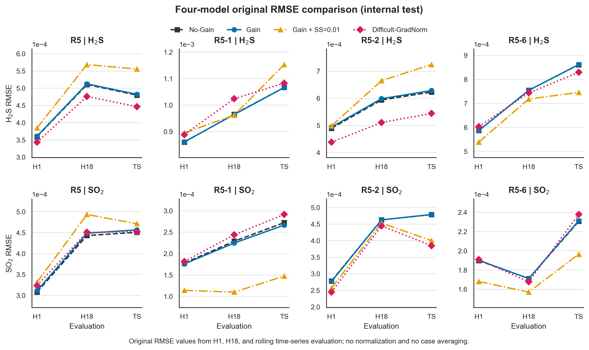

## 四模型原始 RMSE：外插 R5-19～R5-26

[PNG 原圖](four_model_rmse_visualization_seed43/four_model_raw_rmse_external_all_data.png) · [PDF](four_model_rmse_visualization_seed43/four_model_raw_rmse_external_all_data.pdf)

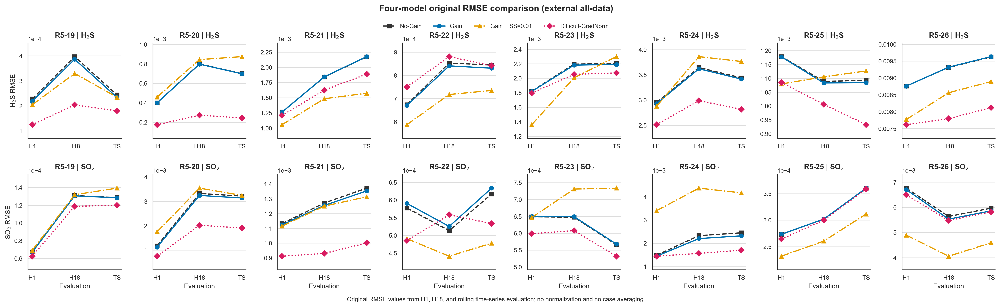

## Gain 相對 No-Gain 的 R²／RMSE 改善熱圖

[PNG 原圖](four_model_rmse_visualization_seed43/gain_vs_no_gain_r2_rmse_heatmap.png) · [PDF](four_model_rmse_visualization_seed43/gain_vs_no_gain_r2_rmse_heatmap.pdf)

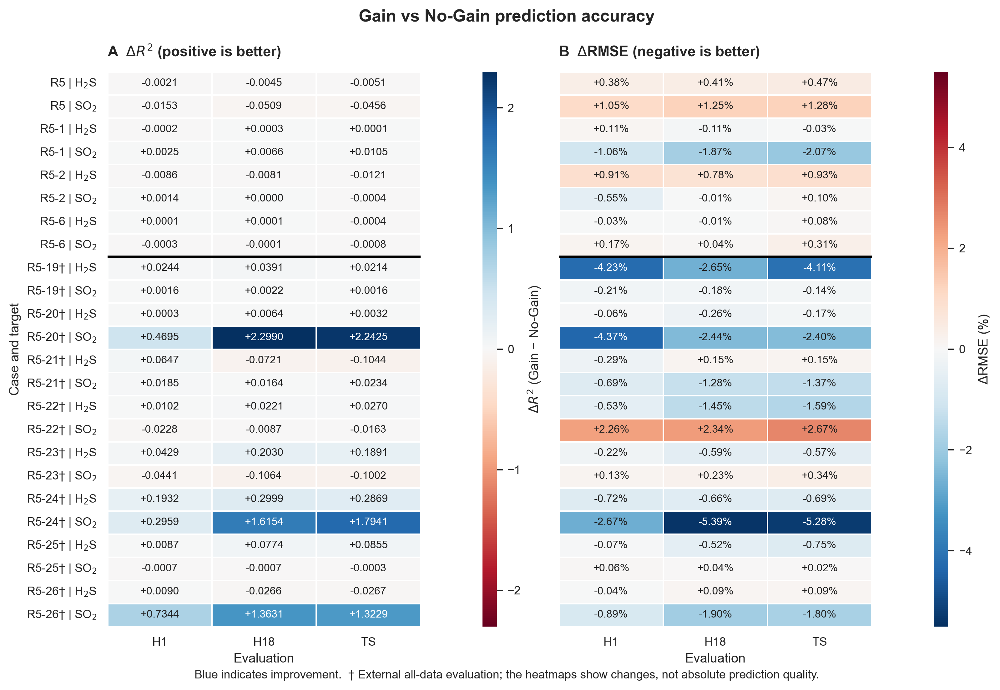

## Gain＋SS=0.01 相對 No-Gain 的改善熱圖

[PNG 原圖](four_model_rmse_visualization_seed43/gain_plus_ss001_vs_no_gain_r2_rmse_heatmap.png) · [PDF](four_model_rmse_visualization_seed43/gain_plus_ss001_vs_no_gain_r2_rmse_heatmap.pdf)

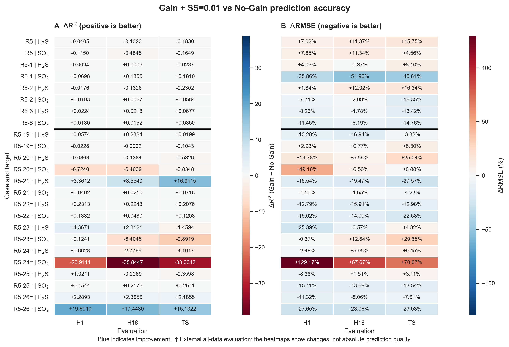

## Difficult-GradNorm 相對 No-Gain 的改善熱圖

[PNG 原圖](four_model_rmse_visualization_seed43/difficult-gradnorm_vs_no_gain_r2_rmse_heatmap.png) · [PDF](four_model_rmse_visualization_seed43/difficult-gradnorm_vs_no_gain_r2_rmse_heatmap.pdf)

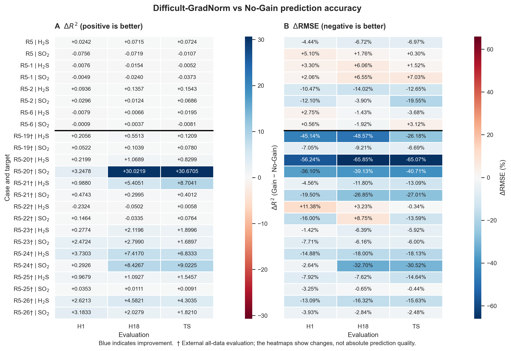

## 四模型 all18 KCI 配對比較

[PNG 原圖](kci_pair_visualization_seed43_in_soft_ood/raw_kci_four_model_comparison.png) · [PDF](kci_pair_visualization_seed43_in_soft_ood/raw_kci_four_model_comparison.pdf)

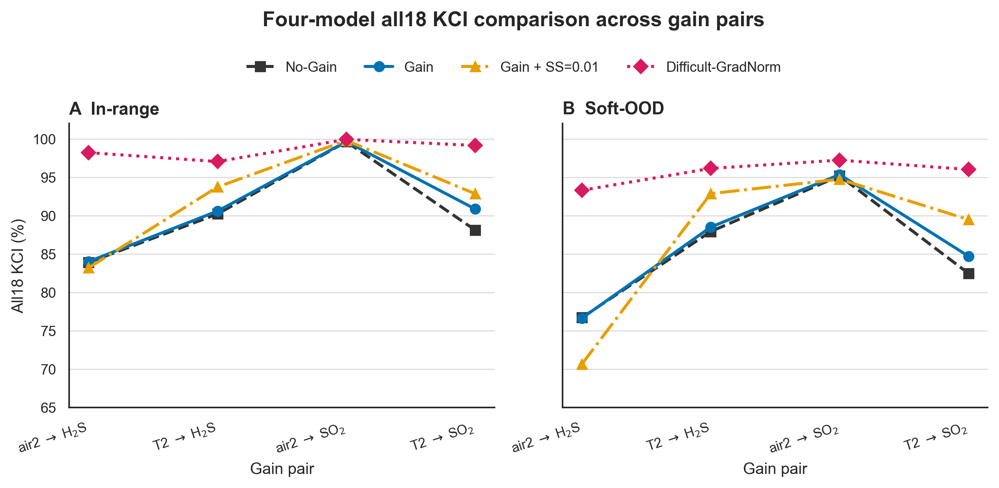

## No-Gain／Gain 的 all18 KCI 比較

[PNG 原圖](kci_pair_visualization_seed43_in_soft_ood/raw_kci_no_gain_vs_gain_only.png) · [PDF](kci_pair_visualization_seed43_in_soft_ood/raw_kci_no_gain_vs_gain_only.pdf)

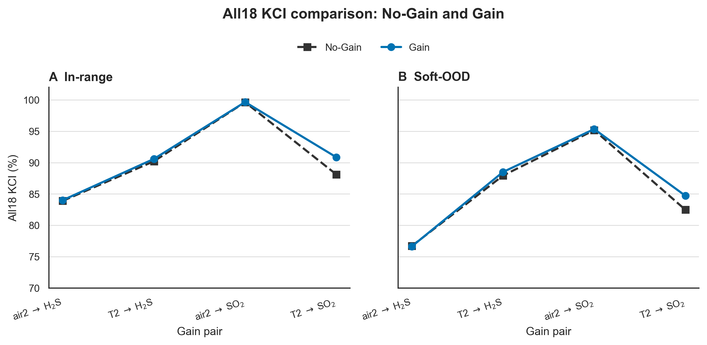

## No-Gain／Gain＋SS=0.01／Difficult-GradNorm 的 KCI 比較

[PNG 原圖](kci_pair_visualization_seed43_in_soft_ood/raw_kci_no_gain_vs_gain_ss.png) · [PDF](kci_pair_visualization_seed43_in_soft_ood/raw_kci_no_gain_vs_gain_ss.pdf)

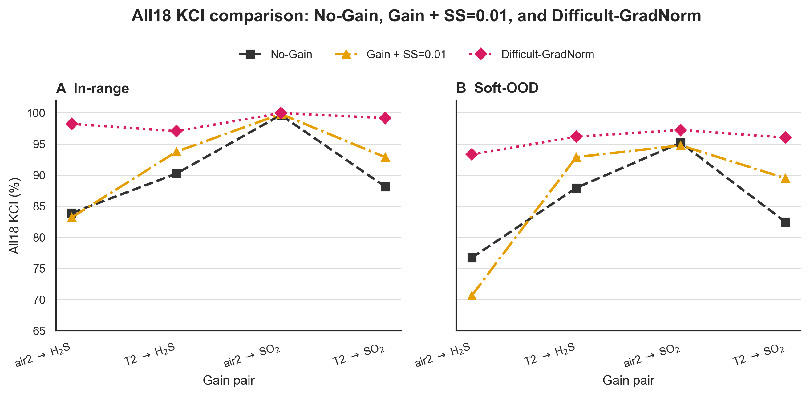

## Teacher Gain 大小與正負號分布

[PNG 原圖](gain_pair_difficulty_seed43/teacher_gain_landscape.png) · [PDF](gain_pair_difficulty_seed43/teacher_gain_landscape.pdf)

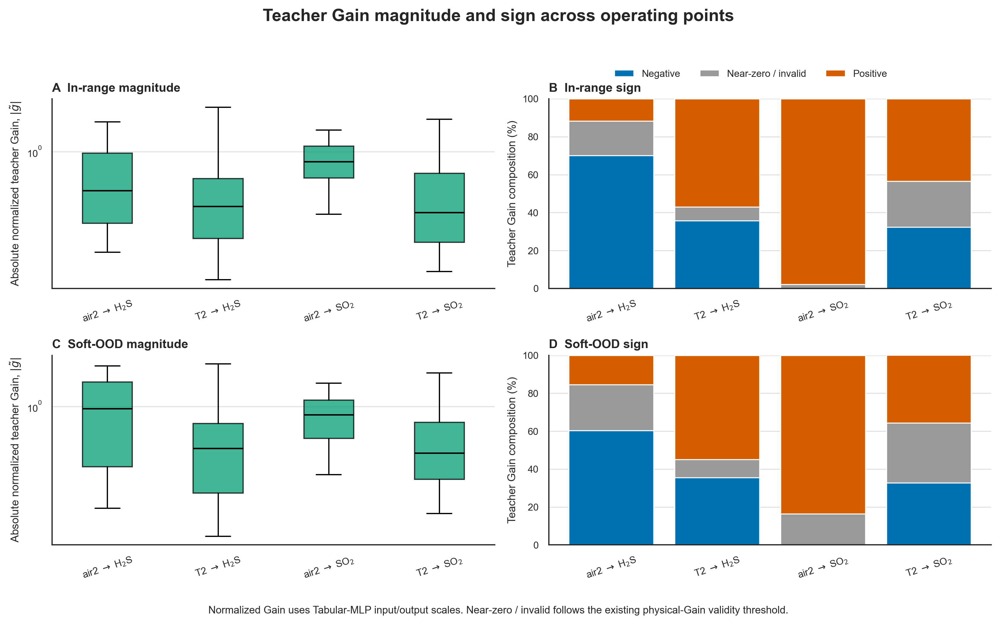

## 依 teacher Gain 大小四分位數分組的 KCI

[PNG 原圖](gain_pair_difficulty_seed43/conditional_kci_by_gain_magnitude.png) · [PDF](gain_pair_difficulty_seed43/conditional_kci_by_gain_magnitude.pdf)

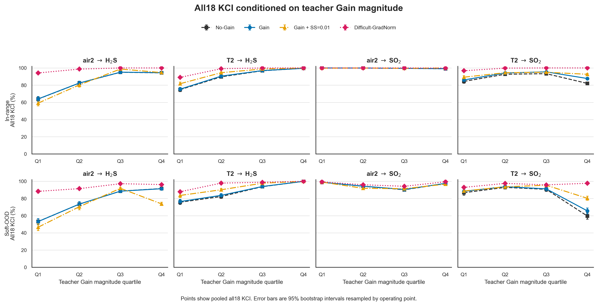

## 依 teacher Gain 正負號分組的 KCI

[PNG 原圖](gain_pair_difficulty_seed43/conditional_kci_by_teacher_sign.png) · [PDF](gain_pair_difficulty_seed43/conditional_kci_by_teacher_sign.pdf)

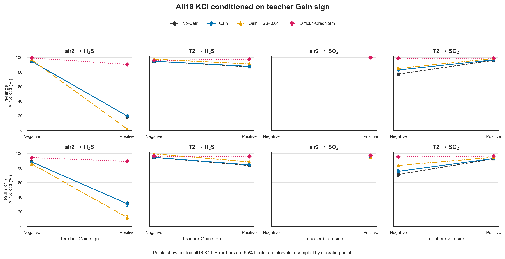
